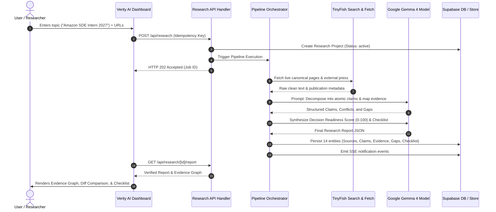

# Verity AI

<div align="center">


### Turn Information into Confidence — Verify Before You Decide.

[](https://nextjs.org/)
[](https://www.typescriptlang.org/)
[](https://tailwindcss.com/)
[](https://ai.google.dev/)
[](https://tinyfish.ai/)
[](https://supabase.com/)

**An AI-assisted information research and verification engine that uncovers what is true, exposes what is missing, detects contradictions across sources, and delivers actionable, evidence-backed verification checklists.**

[Problem](#the-problem--the-digital-dark-spot) • [Solution](#our-solution--verity-ai) • [Live Demos & Screenshots](#application-screenshots) • [Architecture](#how-it-works) • [Tech Stack](#technology-stack) • [Quickstart](#getting-started) • [Pipeline](#ai-and-research-pipeline) • [Roadmap](#future-roadmap)

</div>

---

## The Problem — The Digital Dark Spot

Every day, students, applicants, consumers, and researchers make high-stakes life decisions based on fragmented information:

- **College & Internship Applications:** Portals publish two different job listings for the same opening with conflicting graduation years and unannounced 6-month full-time on-site requirements.
- **National Scholarships & Subsidies:** Guidelines state an income limit of ₹3.5 Lakhs, but bury local state verification cutoff dates and mandatory biometric identity requirements in separate PDF circulars.
- **Open Source Mentorships & Grants:** Program timelines change by a week, stipends are adjusted, and eligibility expands to gap-year students—yet outdated blogs continue to circulate obsolete rules.

### Why Conventional Search & LLMs Fail
1. **Traditional Search Engines** index pages by SEO ranking, not veracity. They return ten disjointed links and leave the burden of manual cross-referencing on the user.
2. **Standard AI Chatbots** synthesize smooth, convincing prose that blurs nuances, invents missing details (hallucinations), and smooths over genuine real-world contradictions.

This gap is the **Digital Dark Spot**—the silent zone between what an applicant reads on a landing page and the strict, unstated conditions buried across ancillary terms, institutional portals, and official records.

---

## Our Solution — Verity AI

> **Core Philosophy:** *"Give every important claim the evidence it deserves."*

Verity AI transforms research from passive reading into an active, verifiable audit. Instead of generating ungrounded opinions, Verity AI:
1. **Deconstructs queries** into targeted retrieval vectors across live web portals and uploaded documents.
2. **Decomposes documents into atomic claims** (dates, amounts, criteria, prerequisites, quotas).
3. **Cross-references claims across independent sources** to corroborate consensus facts.
4. **Detects what is missing** (unstated deadlines, undisclosed stipends, hidden prerequisite clauses).
5. **Flags direct contradictions** between competing versions of the same guidelines.
6. **Produces a visual Evidence Graph** mapping every claim to cited source excerpts.
7. **Issues an Actionable Verification Checklist** giving the user an evidence-backed decision path.

---

## Key Features

| Capability | Status | Description |
| :--- | :---: | :--- |
| **Multi-Source Web Crawling** | Implemented | Autonomous live source discovery and content retrieval via TinyFish Web Search and Fetch APIs. |
| **Document Ingestion** | Implemented | Server-side parsing of uploaded application PDFs and guidelines via `pdf-parse` with raw-text extraction. |
| **Atomic Claim Decomposition** | Implemented | Deconstructs unstructured announcements into testable factual claims using Google Gemma 4. |
| **Corroboration Engine** | Implemented | Evaluates claims across sources to mark statuses: `CORROBORATED`, `CONFLICTING`, `MISSING`, or `UNVERIFIED`. |
| **Interactive Evidence Graph** | Implemented | Visual SVG node map visualizing connections between official websites, community sources, claims, and context. |
| **Side-by-Side Research Comparison** | Implemented | Synchronized text diff viewer highlighting additions (green), removals (red), and structural modifications. |
| **Comparison Summary Metrics** | Implemented | 2x2 categorical breakdown (+Additions, -Removals, Modifications, Total Changes) with Potential Impact analysis. |
| **Gap & Ambiguity Flagging** | Implemented | Explicitly surfaces what official announcements failed to specify (e.g. unstated closing dates, missing forms). |
| **Prioritized Verification Checklist** | Implemented | Actionable, prioritized next steps with concrete rationale to protect candidates before applying. |
| **Real-Time Notification Center** | Implemented | Dynamic, time-stamped alerts triggered as pipeline stages finish, sources are indexed, and gaps are flagged. |
| **Resilient Storage Architecture** | Implemented | Primary Supabase PostgreSQL storage with automatic fallback to an atomic local store (`.verity_store.json`). |
| **Enterprise Row Level Security (RLS)** | Implemented | SQL migrations securing all 14 database tables with dedicated access policies for auth and service roles. |

---

## How It Works

### Architecture Diagram

```mermaid
flowchart TD
    subgraph Client["Frontend Client (Next.js 14 App Router)"]
        UI["Landing & Dashboard UI"]
        EE["Evidence Explorer & SVG Graph"]
        RC["Research Comparison Diff"]
        NC["Notifications & Checklist"]
    end

    subgraph API["Next.js Serverless API Layer"]
        R_API["/api/research (POST / GET)"]
        N_API["/api/notifications"]
        U_API["/api/documents/upload"]
        A_API["/api/auth (Supabase Auth)"]
    end

    subgraph Pipeline["Durable Research Pipeline (Worker)"]
        Orch["Pipeline Orchestrator"]
        Crawler["TinyFish Search & Fetch API"]
        DocParser["PDF Text Extraction Engine"]
        GemmaEngine["Google Gemma 4 (26B-A4B-IT)"]
        Synthesis["Evidence & Gap Synthesizer"]
    end

    subgraph Storage["Persistence & Data Integrity"]
        Supa[("Supabase PostgreSQL (14 Tables + RLS)")]
        LocalStore[("Resilient Local Fallback Store (.verity_store.json)")]
    end

    UI -->|Submit Question & URLs| R_API
    UI -->|Upload Document| U_API
    UI -->|Real-Time State Polling| R_API
    UI -->|Fetch Alerts| N_API

    R_API -->|Dispatch Background Job| Orch
    U_API -->|Extracted Text| Orch

    Orch -->|Query & Crawl| Crawler
    Orch -->|Process Files| DocParser
    Crawler -->|Raw Page Content| GemmaEngine
    DocParser -->|Document Text| GemmaEngine

    GemmaEngine -->|Structured Claim JSON| Synthesis
    Synthesis -->|Claims, Evidence, Gaps, Conflicts, Checklist| Supa
    Synthesis -.->|Fail-Safe Sync| LocalStore

    Supa --> UI
    LocalStore -.-> UI
```



### End-to-End Information Flow



---

## Technology Stack

| Layer | Technology | Version | Purpose in Verity AI |
| :--- | :--- | :--- | :--- |
| **Framework** | Next.js (App Router) | `14.2.24` | Server-rendered pages, API routes, and client-side view orchestration. |
| **Language** | TypeScript | `5.7.3` | Strict type safety across database schemas, pipelines, and UI components. |
| **Styling** | Tailwind CSS | `3.4.17` | Responsive layout, custom typography (Inter + Newsreader), design tokens. |
| **Icons** | Lucide React | `0.475.0` | Clean, accessible iconography across navigation, status badges, and controls. |
| **AI Intelligence** | Google Gemma 4 | `26B-A4B-IT` | Claim decomposition, cross-source contradiction evaluation, structured synthesis. |
| **Web Crawling** | TinyFish API | `v1` | Live web search and clean full-text fetching from dynamic web portals. |
| **Database** | Supabase (PostgreSQL) | `2.48.1` | Relational storage for 14 schema entities with active Row Level Security. |
| **Authentication** | Supabase Auth | `v2` | Secure user sign-up, sign-in, session tokens, and cookie handling. |
| **File Processing** | `pdf-parse` | `1.1.1` | High-throughput binary extraction of text from uploaded PDF circulars. |
| **Execution** | Node.js / `tsx` | `20+` | Asynchronous worker execution and development runtime. |

---

## Application Screenshots

<div align="center">

### 1. Landing Page — "Verify Before You Decide"
*Public gateway introducing the problem of scattered information and the evidence-backed decision path.*


---

### 2. Research Dashboard & Live Activity Donut
*Central research command center featuring quick-investigation inputs, active research table, and live status donut.*


---

### 3. Evidence Explorer & Visual Node Graph
*Three-column exploration showing atomic claims, quoted evidence excerpts with working source links, and an interactive SVG evidence map.*


---

### 4. Side-by-Side Research Comparison & Diff
*Deep comparative analysis between competing guidelines, displaying red strikethrough deletions, green additions, and summary metrics.*


---

### 5. Prioritized Verification Checklist
*Actionable checklist with concrete rationale and priority badges to guide users before submitting applications.*


---

### 6. Notifications & Live Alerts Center
*Real-time alert dispatch tracking source discovery, critical gap detection, and verification milestones.*


</div>

---

## Project Structure

```text
Verity AI/
├── Assets/
├── public/
├── src/
│   ├── app/
│   │   ├── (dashboard)/
│   │   │   ├── comparison/
│   │   │   ├── dashboard/
│   │   │   ├── documents/
│   │   │   ├── help/
│   │   │   ├── my-research/
│   │   │   ├── notifications/
│   │   │   ├── pricing/
│   │   │   ├── profile/
│   │   │   ├── research/
│   │   │   │   ├── [id]/
│   │   │   │   │   ├── checklist/
│   │   │   │   │   ├── evidence/
│   │   │   │   │   ├── findings/
│   │   │   │   │   ├── progress/
│   │   │   │   │   ├── report/
│   │   │   │   │   └── sources/
│   │   │   │   └── new/
│   │   │   ├── saved/
│   │   │   ├── security/
│   │   │   └── layout.tsx
│   │   ├── api/
│   │   │   ├── auth/
│   │   │   ├── checklist/
│   │   │   ├── documents/
│   │   │   ├── health/
│   │   │   ├── notifications/
│   │   │   ├── profile/
│   │   │   ├── research/
│   │   │   └── saved/
│   │   ├── auth/
│   │   ├── layout.tsx
│   │   └── page.tsx
│   ├── components/
│   │   ├── auth/
│   │   ├── layout/
│   │   └── research/
│   └── lib/
│       ├── ai/
│       ├── db/
│       ├── documents/
│       ├── supabase/
│       ├── tinyfish/
│       ├── types/
│       └── worker/
├── supabase/
│   └── migrations/
│       ├── 20261030_init.sql
│       └── 20261101_enable_rls.sql
├── .env.example
├── package.json
├── tailwind.config.ts
└── tsconfig.json
```

---

## Getting Started

### Prerequisites
- **Node.js**: `v18.17.0` or higher (`v20+` recommended)
- **npm** or **pnpm**
- **Git**
- A **Google Gemini API Key** (for Gemma 4 inference)
- A **TinyFish API Key** (for web intelligence search and page fetching)
- *(Optional)* A **Supabase Project** (for multi-user cloud database storage)

---

### Installation & Setup

1. **Clone the repository:**
   ```bash
   git clone https://github.com/Kanneboinashivakumar/VerityAI.git
   cd VerityAI
   ```

2. **Install project dependencies:**
   ```bash
   npm install
   ```

3. **Configure Environment Variables:**
   Copy the example environment configuration:
   ```bash
   cp .env.example .env.local
   ```
   Open `.env.local` and add your Gemini and TinyFish keys based on `.env.example`.

4. **Database Configuration (Supabase):**
   - If using Supabase, navigate to the **SQL Editor** in your Supabase Dashboard.
   - Run the initial migration script: [`supabase/migrations/20261030_init.sql`](supabase/migrations/20261030_init.sql).
   - Run the security migration to activate Row Level Security: [`supabase/migrations/20261101_enable_rls.sql`](supabase/migrations/20261101_enable_rls.sql).
   - *Note: If Supabase credentials are not provided, Verity AI automatically falls back to its local disk store (`.verity_store.json`), allowing full offline testing.*

5. **Start the local development server:**
   ```bash
   npm run dev
   ```

6. **Open the application:**
   Navigate to [http://localhost:3000](http://localhost:3000) in your browser.

---

## AI and Research Pipeline

Verity AI treats language models as **strict analytical extractors**, not generative authors.

```text
[Raw Web Pages & PDFs]
          │
          ▼
   1. Text Sanitization & Token Windowing
          │
          ▼
   2. Prompt-Constrained Atomic Claim Extraction (Gemma 4)
          ├── Extracts Subject, Predicate, Value, Timeframe, Conditions
          └── Enforces Strict Grounding: Every claim MUST cite exact source excerpt
          │
          ▼
   3. Multi-Source Corroboration Engine
          ├── Matches matching normalized claims across distinct publisher domains
          ├── Evaluates agreement -> CORROBORATED
          └── Detects conflicting parameters -> CONFLICTING
          │
          ▼
   4. Negative Space & Information Gap Analysis
          ├── Compares extracted claims against standard query requirement templates
          └── Identifies missing critical parameters -> INFORMATION GAP
          │
          ▼
   5. Decision Readiness & Verification Checklist Synthesis
          └── Quantifies Readiness Score (0-100) & Prioritized Next Steps
```

- **Zero Hallucination Tolerance:** If a date, stipend, or eligibility rule cannot be tied to a verbatim quote in an ingested source, the system is strictly instructed to classify it as an `INFORMATION GAP` rather than guessing.
- **Traceability:** Every node in the Evidence Explorer links directly to its parent URL, publisher credibility rating, and original excerpt.

---

## Example Real-World Use Cases

1. **Amazon Software Development Engineer Intern (2027 Batch):**
   - *Query:* Comparing official requisitions `Job ID 10541345` vs `Job ID 10517894`.
   - *Verity AI Finding:* Confirms strict 2027 graduation eligibility and exposes an unannounced 6-month university NOC requirement for full-time 40 hrs/week on-site presence.
2. **National Means-cum-Merit Scholarship Scheme (NMMSS 2026–27):**
   - *Query:* Verifying state examination dates and income ceilings.
   - *Verity AI Finding:* Validates the ₹3.5 Lakh income ceiling and flags conflicting L1 Institute vs L2 District verification deadlines across state portals.
3. **Gnani AI Great Indian AI Internship Challenge 2026:**
   - *Query:* Verifying the 100 paid internships claim with stipends up to ₹1 Lakh/month.
   - *Verity AI Finding:* Corroborates the stipend claims via official announcements and independent press coverage while flagging an unverified direct GitHub submission portal.
4. **Google Summer of Code (GSoC 2026 vs 2027 Guidelines):**
   - *Query:* Detecting structural policy updates.
   - *Verity AI Finding:* Exposes an expansion allowing gap-year contributors and a revised stipend schedule.

---

## Reliability, Privacy and Security

- **Server-Side Credential Isolation:** All TinyFish and Gemini API keys reside exclusively in Node.js server environments; zero API keys or secrets are exposed to client bundles.
- **Row Level Security (RLS):** Supabase migrations enforce granular PostgreSQL policies across all 14 tables, preventing unauthorized cross-tenant reads or writes.
- **Input Validation & DoS Protection:** URL inputs are validated against protocol schemes; PDF uploads are subject to file-size constraints and sanitization before buffer processing.
- **Resilient Fallback Storage:** If cloud database connectivity is interrupted, the platform switches seamlessly to a persistent local store without crashing user workflows.

---

## Current Limitations

- **Scanned Image PDFs:** Current document parsing relies on digital text layers (`pdf-parse`); image-only rasterized scanned PDFs require pre-OCR processing.
- **Paywalled & CAPTCHA-Guarded Sites:** Sites enforcing strict cloudflare challenge screens or requiring subscriber logins may return partial summaries or trigger accessibility warnings.
- **Primary Language Focus:** The extraction heuristics and prompt schemas are currently optimized for English-language official documents.

---

## Future Roadmap

- [ ] **Cross-Lingual Verification:** Expanding source retrieval and claim extraction across regional Indian languages (Hindi, Telugu, Tamil, Marathi, Kannada).
- [ ] **Automated Re-Verification Cron Bots:** Scheduled background monitoring to alert users when a previously analyzed portal updates deadlines or policies.
- [ ] **Chrome Browser Extension:** One-click page verification directly while browsing job boards and scholarship portals.
- [ ] **OCR Engine Integration:** Native Tesseract / Document AI integration for scanned government gazette notifications.

---

## Contributing

Contributions, feedback, and pull requests are welcome:

1. **Fork the Repository:** Click the `Fork` button on GitHub.
2. **Create a Feature Branch:**
   ```bash
   git checkout -b feature/evidence-graph-zoom
   ```
3. **Commit Your Changes:**
   ```bash
   git commit -m "feat: add interactive zoom controls to evidence graph"
   ```
4. **Push to the Branch:**
   ```bash
   git push origin feature/evidence-graph-zoom
   ```
5. **Open a Pull Request** detailing your enhancements.

---

## License

This project is licensed under the [MIT License](LICENSE).

---

## Team and Acknowledgements

- **Project:** **Verity AI**
- **Problem Statement:** **Digital Dark Spot**
- **Hackathon:** **Shinchan Online Hackathon 2026**
- **Team:** **Team StrawHat**
- **Participation:** **Solo Participant**
- **Developer:** **Kanneboina Shiva Kumar** ([@Kanneboinashivakumar](https://github.com/Kanneboinashivakumar))

Special thanks to the engineering teams behind **Google Gemma 4**, **TinyFish**, and **Next.js** for providing the foundational infrastructure powering verifiable intelligence.
